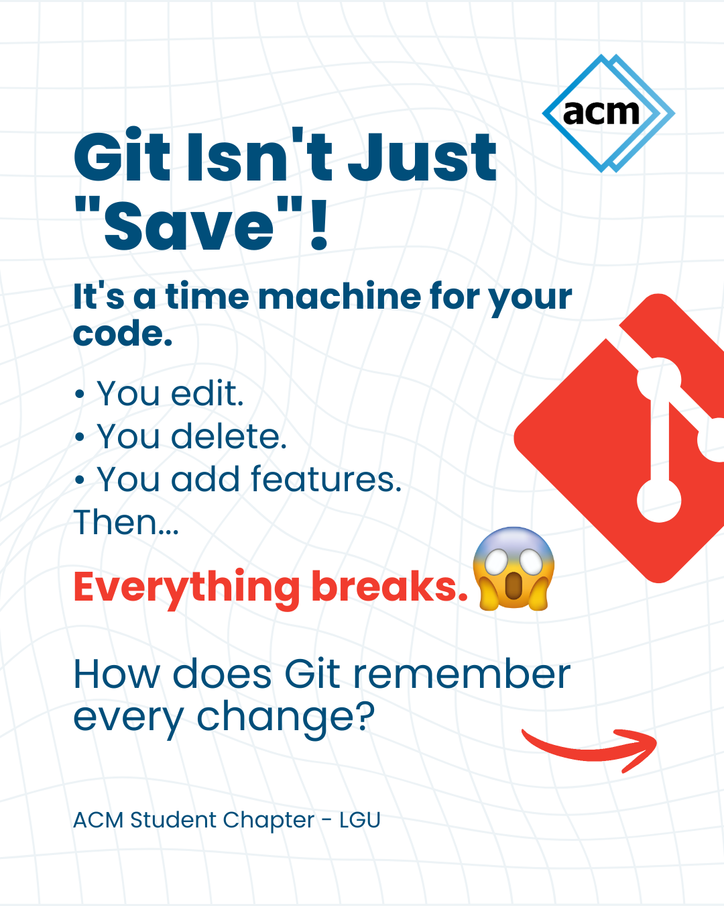
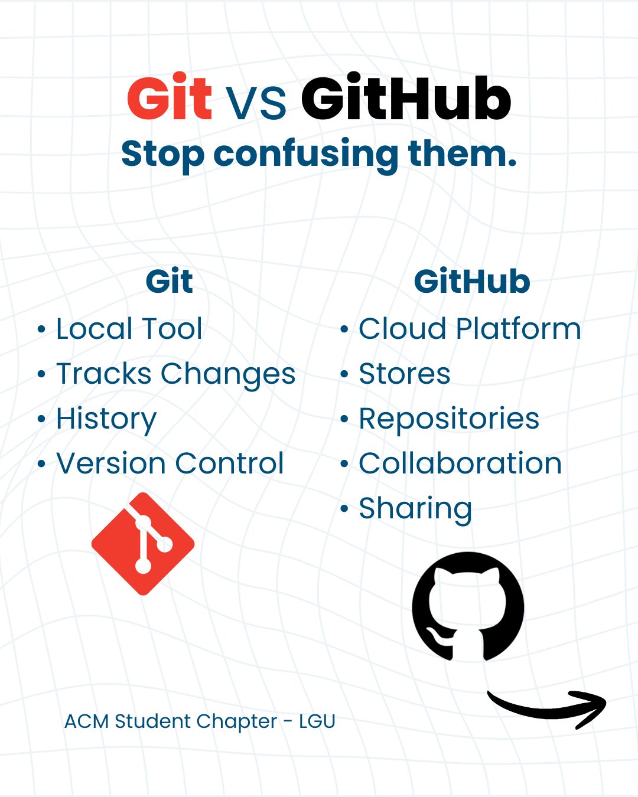
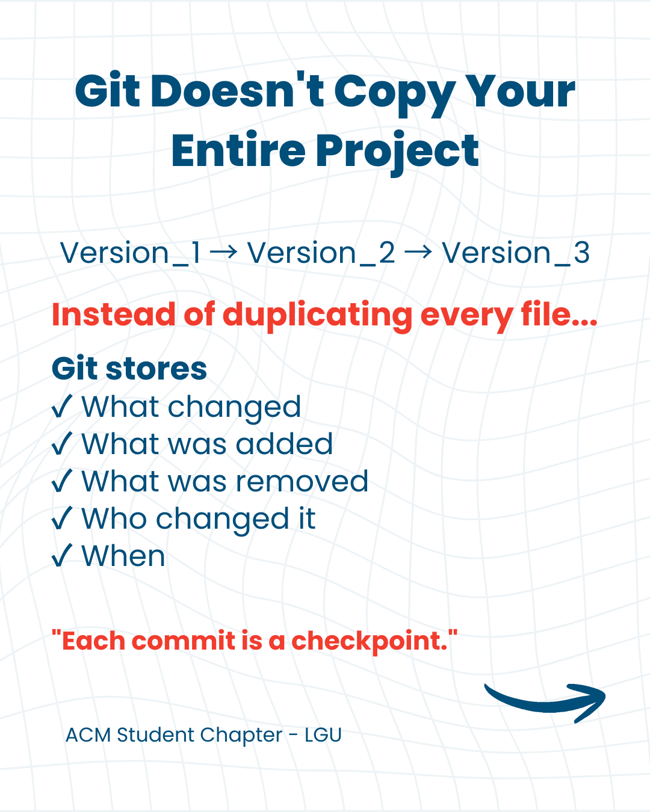
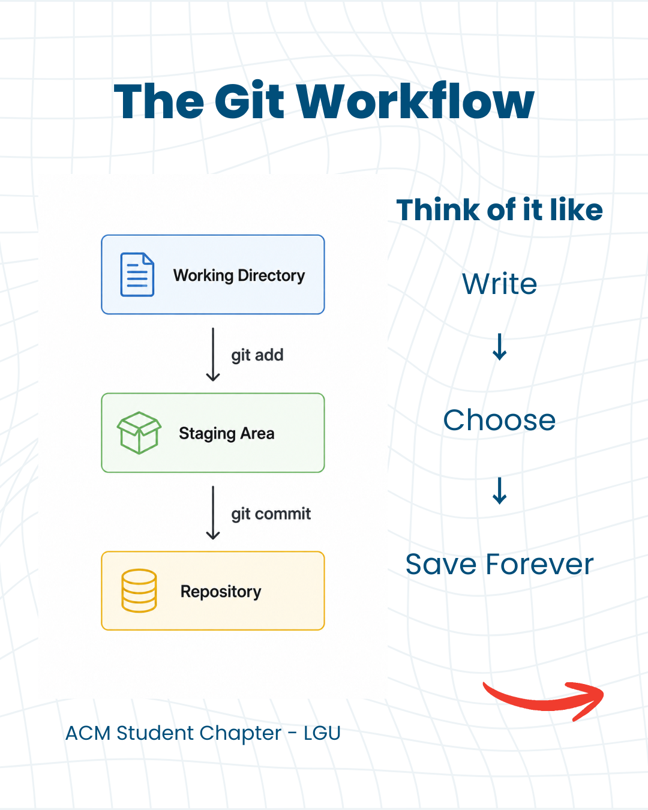
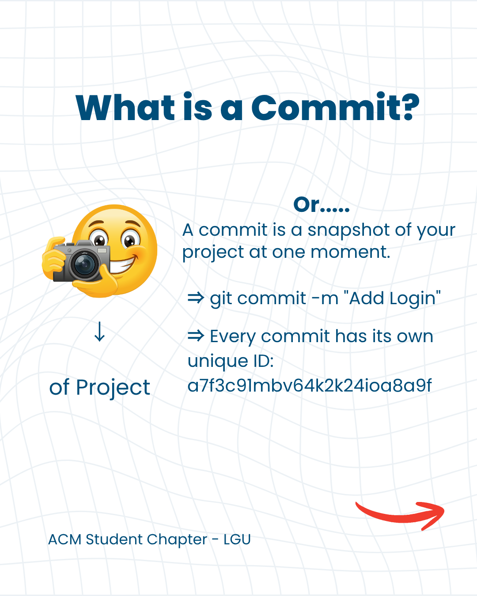
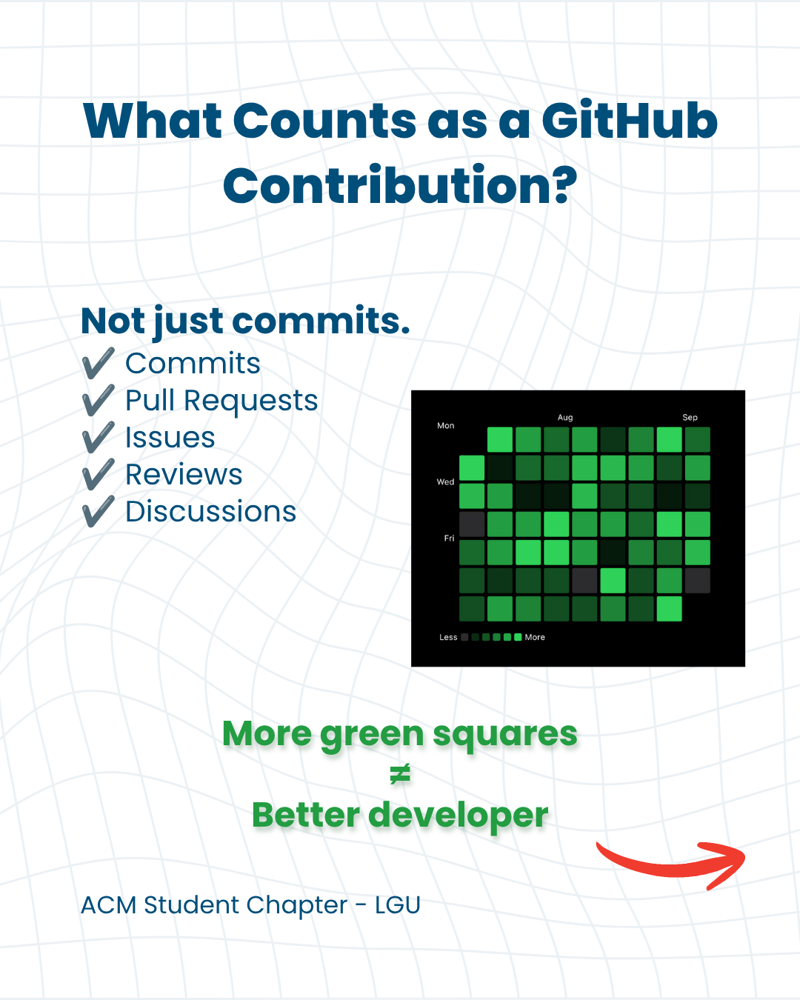
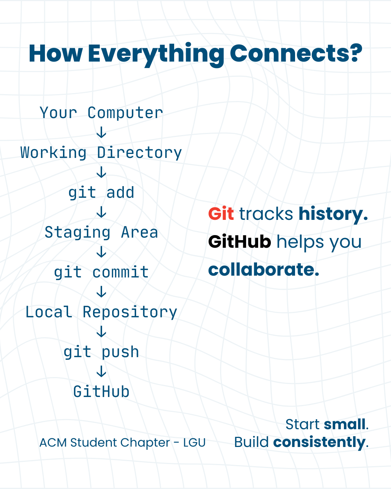

## Overview

This project involves designing educational social media content for the LGU ACM Student Chapter, a student community focused on Development, Innovation, and Research.

The objective was to make technical topics more accessible and engaging for students through informative carousel posts. The content covers software development concepts, Git and GitHub fundamentals, version control, open-source contributions, and essential developer workflows.

Each post is structured to break down complex technical information into smaller, easy-to-understand sections, encouraging students to learn and explore programming concepts through social media.

<!-- ## Rhythm and colour -->
## Final Outcome
Together, these designs create a recognizable educational content series that strengthens the chapter's digital presence, promotes technical learning, and encourages students to engage with the developer community.
