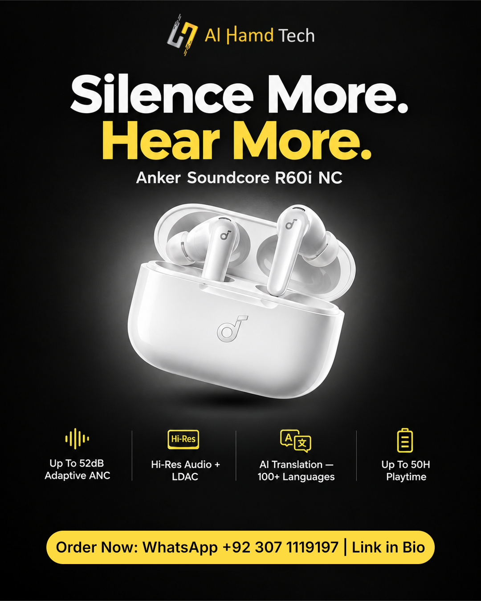
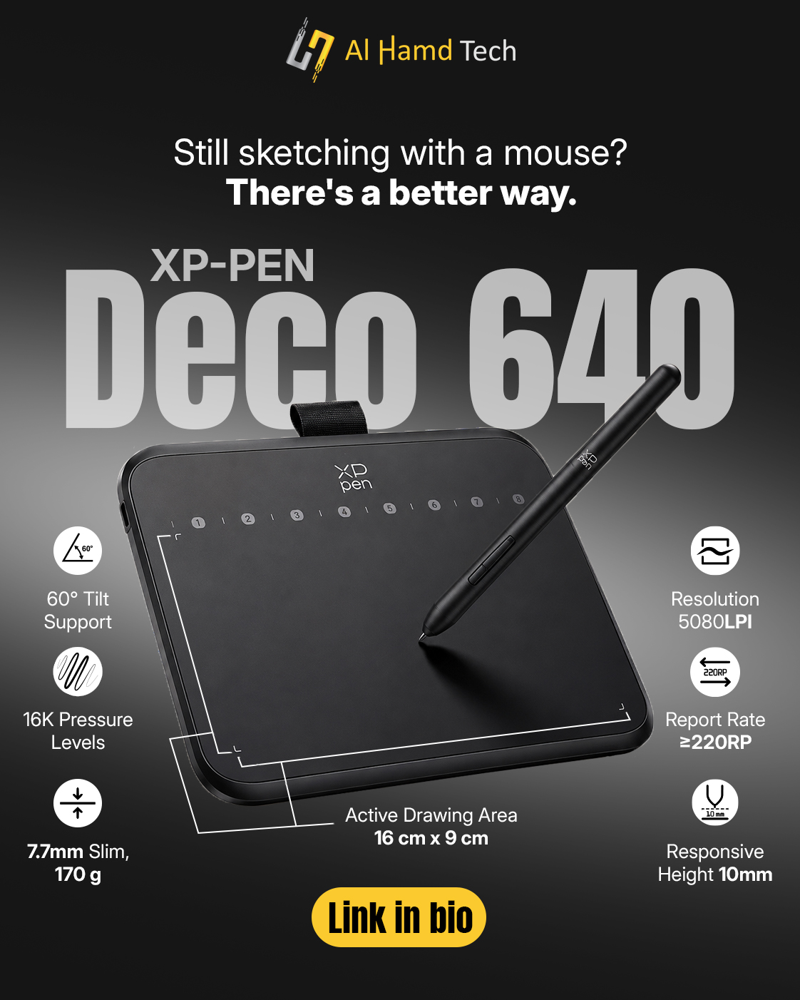

## Overview

Al Hamd Tech is an online technology and electronics retailer offering a wide range of products, including headphones, webcams, wireless accessories, gaming equipment, digital tablets, and smart gadgets.

<!-- ## Rhythm and colour -->
## Final Outcome
The designs include individual product promotions, educational buying guides, feature highlights, product comparisons, and promotional advertisements. Together, they establish a consistent and recognizable visual language that communicates the brand's offerings while making its social media feed more engaging and professional.

