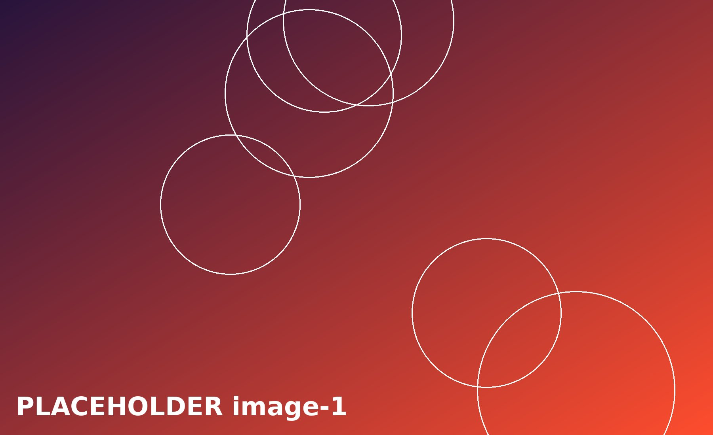
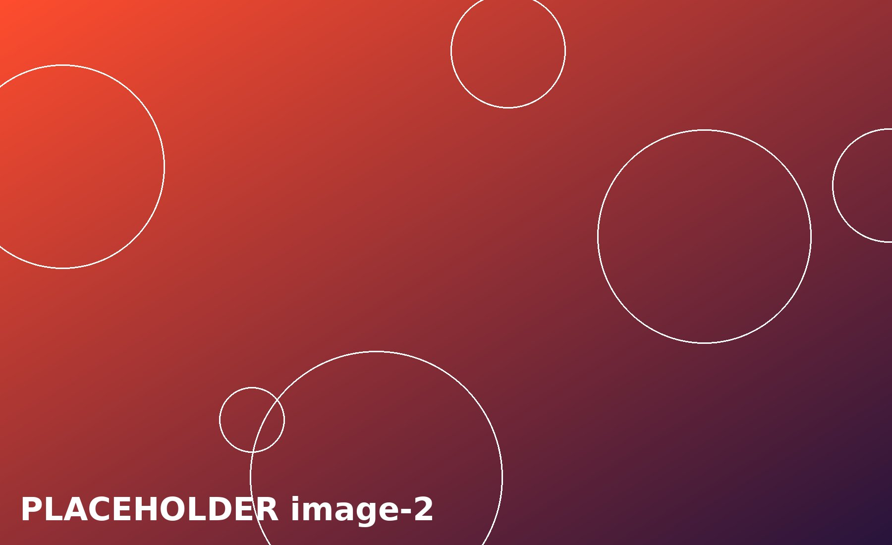

---
# =====================================================================
# PROJECT TEMPLATE — copy this file to add a new project.
# File name = the URL.  brand-identity-nova.md  ->  /work/brand-identity-nova/
#
# title        The project name shown on cards and the project page.
# category     Free text. Same spelling = same filter button on the Work page.
#              A NEW category name automatically creates a NEW filter button.
# year         A number (no quotes). Work page sorts newest first.
# description  1-2 sentences. Used on the page and in Google / social previews.
# cover        Path to the cover image, relative to THIS file.
#              Put images in src/assets/projects/<project-name>/
# coverAlt     Describe the cover image for screen readers (accessibility).
# tools        List of software used, e.g. ["Illustrator", "Photoshop"].
# featured     true = shows on the Home page. Default is false.
# order        Optional number. Lower numbers appear first on the Home page.
#
# Everything BELOW the second --- line is the project story, in Markdown.
# Add images with:  
# =====================================================================
title: "Nova Coffee — Brand Identity"
category: "Branding"
year: 2026
description: "A warm, modern identity for a specialty coffee roaster: logo, colour system, packaging and social templates."
cover: "../../assets/projects/brand-identity-nova/cover.jpg"
coverAlt: "Nova Coffee logo and packaging on a dark background"
tools: ["Illustrator", "Photoshop", "InDesign"]
featured: true
order: 1
---

## The brief

Nova is a small specialty coffee roaster that wanted to feel premium without being cold. The goal was an identity that works on a tiny sticker and on a large shopfront sign.

## The process

I started with pencil sketches of the star-shaped "N" mark, then refined it in Illustrator with a geometric grid so it stays crisp at every size.

## The result

A flexible system: a deep roast-brown and ember-orange palette, a friendly serif for headlines, and packaging that tells the story of each origin.

> Good branding is a promise you can see before you taste.
