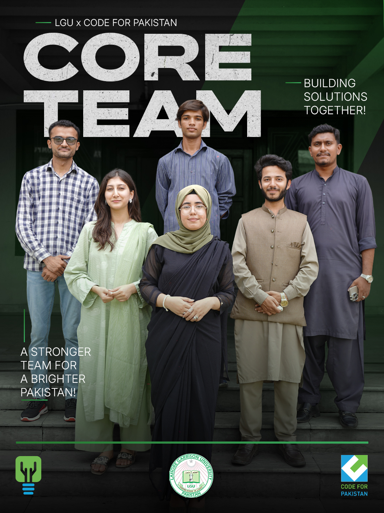
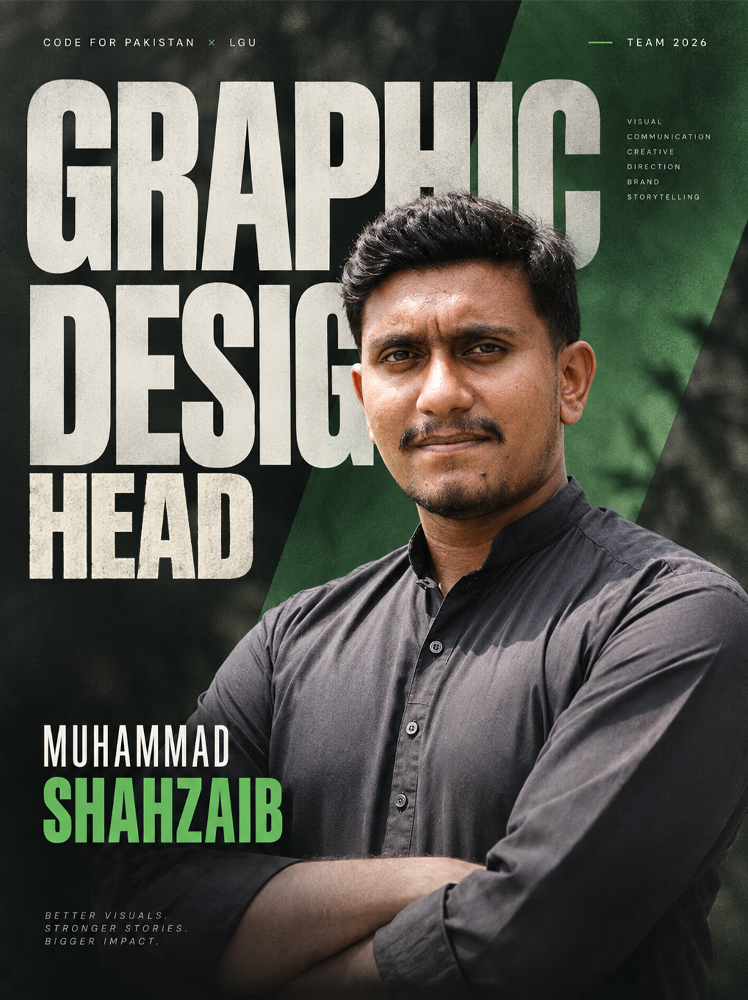
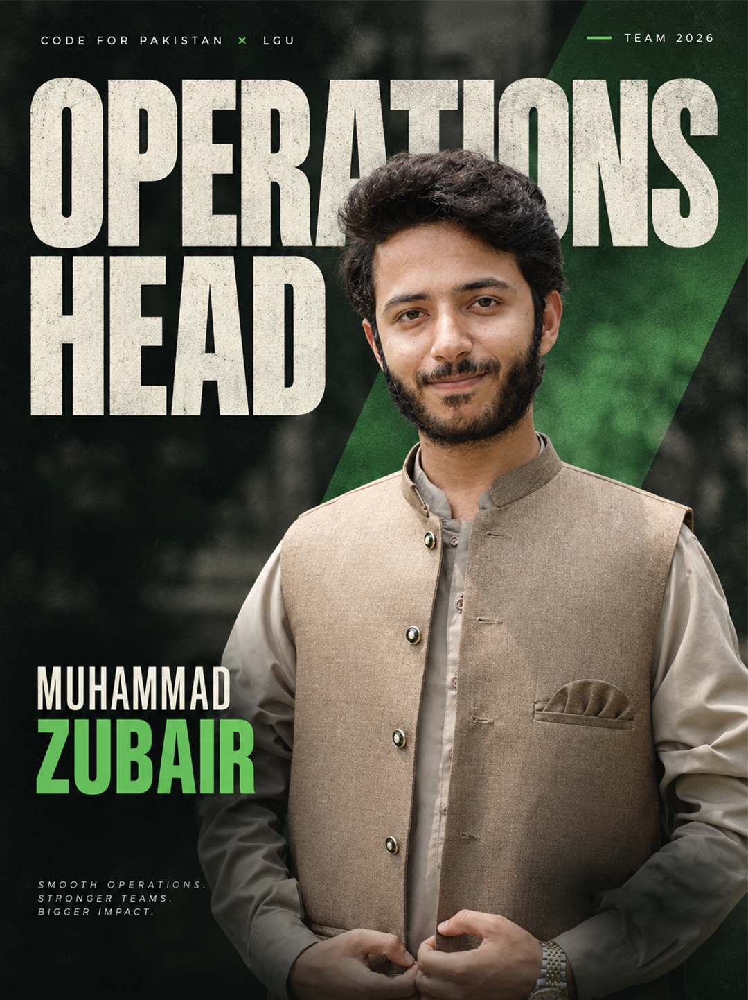
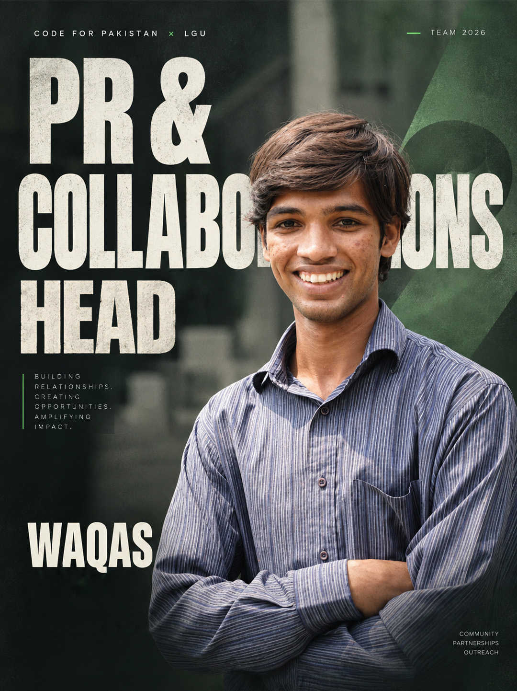
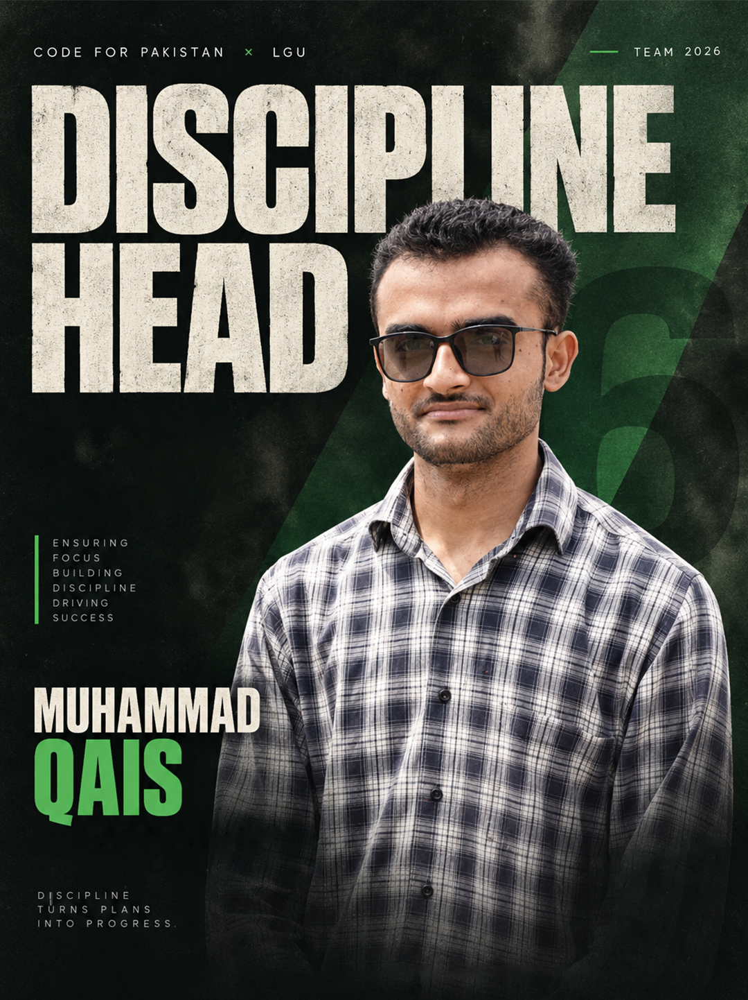
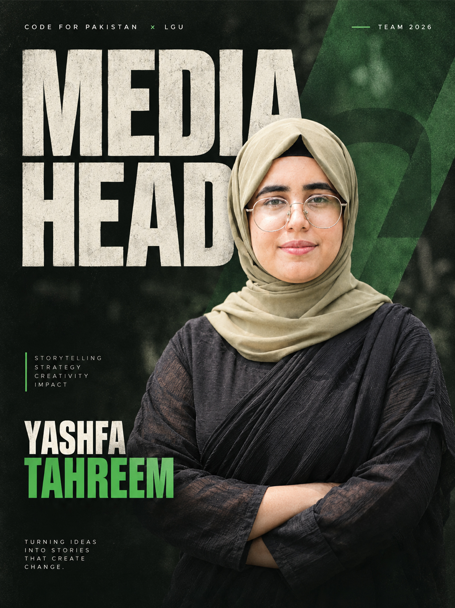
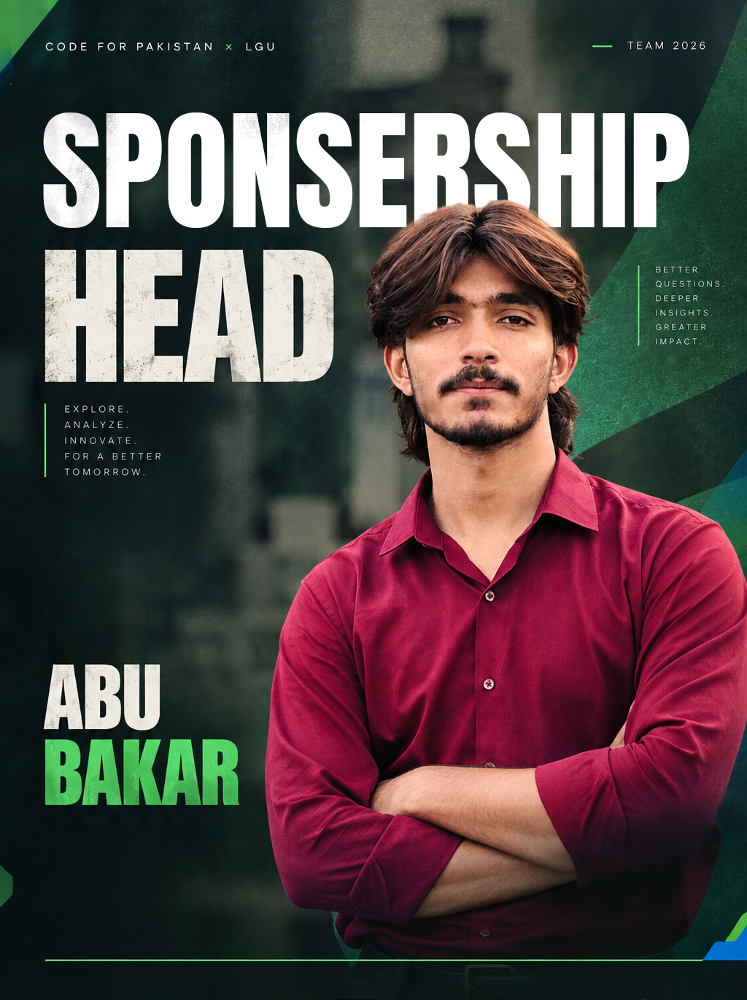

## Overview

This project involves creating a visual identity and social media campaign to introduce the core team of Civic Innovation Labs (CIL) at LGU.

The objective was to introduce the people behind the community, highlighting their respective roles and responsibilities through a collection of individual profile posters and a collective team composition.

## Creative Direction

The creative direction follows a bold, modern, and cinematic visual approach, combining professional portrait photography with a dark, technology-inspired aesthetic.

A deep black and forest-green color palette establishes a distinctive visual atmosphere, complemented by subtle abstract textures, atmospheric lighting, and vibrant green accents.

Oversized condensed typography creates a strong visual hierarchy, making each leadership position the primary focus of its respective poster. Individual names are highlighted using contrasting green typography, while carefully composed portraits add personality and professionalism to the designs.

Consistency across the collection was a key design consideration. Although every poster features a different person and designation, the recurring color palette, typography, layout structure, and visual treatments bring the entire campaign together.

## Final Outcome

The final outcome is a cohesive collection of individual team introduction posters accompanied by a collective core team composition.

Each individual design highlights a team member and their respective leadership position, creating a professional and recognizable presentation of the CIL LGU team.

The complete collection establishes a consistent visual identity for the team's introduction campaign, making it suitable for social media announcements, organizational promotions, and community branding.