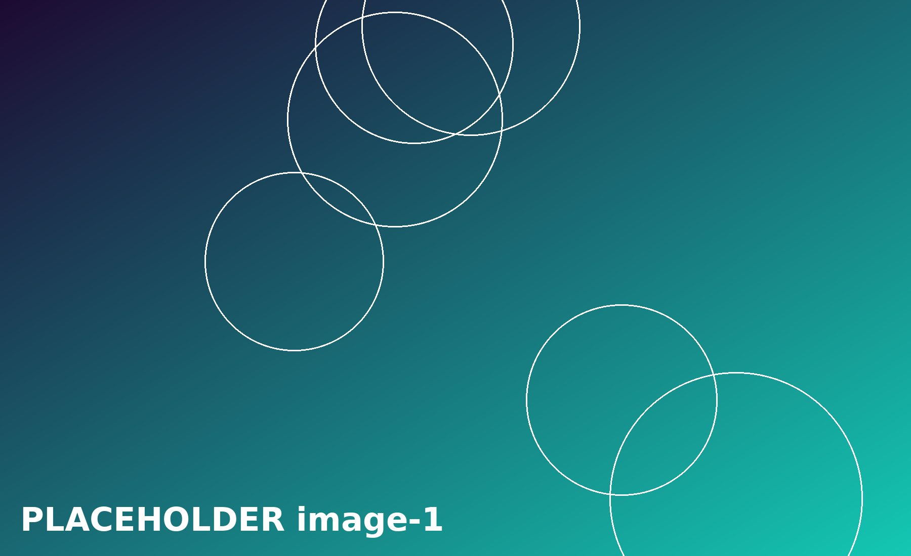
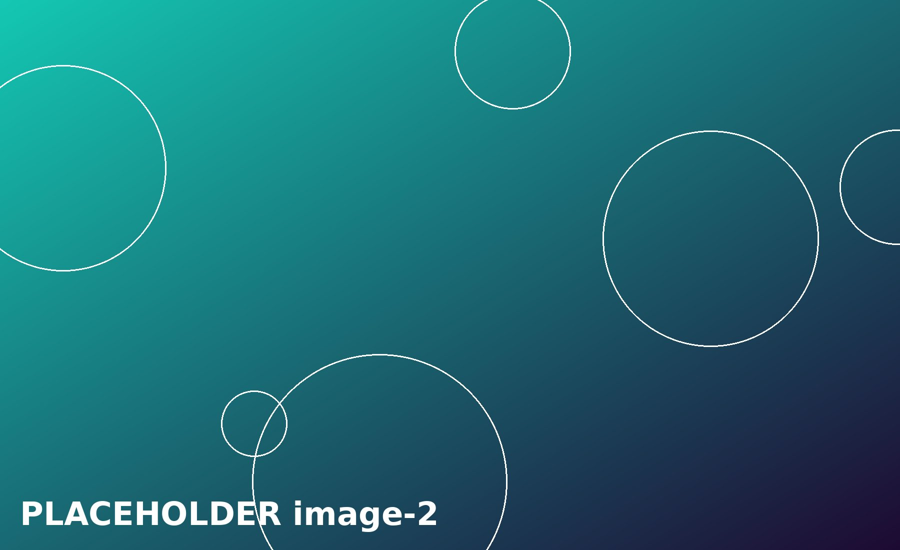

## Concept

Neon Nights is a personal poster series exploring how type can glow, bleed and vibrate on a dark canvas.

## Colour and type

Each poster uses one dominant neon colour against near-black, with a single oversized word as the hero element.

